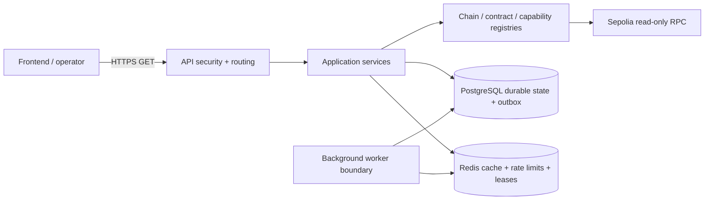

# VortexA Backend

VortexA Backend is the read-only TypeScript service layer for the VortexA vault protocol. It gives a frontend and internal operators a controlled view of verified contract deployments and chain health while PostgreSQL holds durable indexed/application state and Redis supplies ephemeral caching, rate limits, notifications, and distributed leases.

The design is multichain-ready: chain, RPC, deployment, capability, persistence, and cache identities are resolved by chain ID. The current runtime is deliberately restricted to **Ethereum Sepolia (chain ID `11155111`) only**. No signing key is loaded, no API route broadcasts transactions, and fallback RPCs are used only for allowlisted read methods.

## Architecture



Domain and application code depend on ports, not RPC, PostgreSQL, or Redis implementations. `ChainRegistry`, `RpcClientFactory`, `ContractRegistry`, `ChainCapabilityRegistry`, and `ChainAwareContractReader` isolate chain selection from business rules. PostgreSQL keys for vaults, deployments, logs, cursors, balances, and transactions include `chain_id`; new cache/job keys use `chainScopedKey`.

## Technology stack

- Node.js 22 or newer; TypeScript 5.9 in strict `NodeNext` mode.
- Native Node HTTP server and `viem` 2.57 for EVM reads.
- PostgreSQL via `pg` 8.23 and Drizzle ORM 0.45 schema definitions.
- Redis client 6.3 for ephemeral coordination.
- Node test runner, ESLint 10, Prettier 3, and GitHub Actions.

## Environment setup

Copy `.env.example` to the single active local `.env` file. Never commit `.env` or place a private key or production credential in an example file.

In development/test, `.env` is loaded and process environment variables override it. No `.env.local` or `.env.<NODE_ENV>` variants are loaded. When `NODE_ENV=production`, local files are not loaded; Railway/process variables are the only source.

Required production settings include `NODE_ENV=production`, Railway `PORT`, `DATABASE_URL`, `REDIS_URL`, a 32+ character `INTERNAL_API_KEY`, exact HTTPS origins in `CORS_ALLOWED_ORIGINS`, `GLOBAL_RATE_LIMIT`, and the blockchain settings below. Set the same CORS key to local HTTP origins in `.env` and production HTTPS origins in Railway variables. URLs and keys are validated without being returned by an API.

```env
ACTIVE_CHAIN_ID=11155111
SEPOLIA_RPC_URL=https://your-sepolia-provider.example
# Optional: SEPOLIA_RPC_URLS=https://primary.example,https://secondary.example
DATABASE_URL=postgresql://database.internal:5432/vortexa
REDIS_URL=rediss://redis.internal:6379
INTERNAL_API_KEY=replace-with-a-random-server-only-value
CORS_ALLOWED_ORIGINS=https://app.example.com
GLOBAL_RATE_LIMIT=60
RATE_LIMIT_WINDOW_SECONDS=60
TRUST_PROXY=false
CONTRACT_MANIFEST_PATH=packages/contracts/manifests/sepolia-v1.json
CONTRACT_PRICE_GUARD=0x...
CONTRACT_SHAPE_LIBRARY=0x...
CONTRACT_TIMELOCK_CONTROLLER=0x...
CONTRACT_VAULT=0x...
CONTRACT_VAULT_FACTORY=0x...
CONTRACT_VAULT_LENS=0x...
CONTRACT_FEE_COLLECTOR=0x...
CONTRACT_NORMAL_LP_STRATEGY=0x...
CONTRACT_BUY_THE_DIP_STRATEGY=0x...
CONTRACT_SELL_THE_PUMP_STRATEGY=0x...
CONTRACT_SWAP_EXECUTOR=0x...
CONTRACT_ZAP=0x...
LOG_LEVEL=info
INDEXER_ENABLED=false
INDEXER_START_BLOCK=12032363
INDEXER_CONFIRMATIONS=12
INDEXER_MAX_REORG_DEPTH=128
INDEXER_WORKER_ID=unique-worker-id
```

`GLOBAL_RATE_LIMIT` controls the general browser API; chain status and contract status keep stricter hard caps of 30 and 10 requests per window. `TRUST_PROXY` is enabled only when the service is exclusively reachable through one trusted ingress that overwrites or appends the observed client address as the rightmost valid `X-Forwarded-For` value. The API ignores invalid forwarded addresses and falls back to the socket peer. `INDEXER_ENABLED` controls the separate M6 process and requires its database, Redis, worker ID, and approved finality/reorg settings.

All 12 deployment addresses are required `CONTRACT_*` environment variables. The selected manifest contains contract names and reviewed runtime hashes only; it contains no deployment addresses. Mainnet or another chain cannot be activated through configuration in this release.

## Local development (Windows PowerShell)

```powershell
Copy-Item .env.example .env
# Edit .env and replace local placeholders.
npm ci --no-audit --no-fund
npm run typecheck
npm run lint
npm run format:check
npm test
npm run build
npm run start
Invoke-RestMethod http://127.0.0.1:3000/health/live
```

For internal endpoints:

```powershell
$headers = @{ Authorization = "Bearer $env:INTERNAL_API_KEY" }
Invoke-RestMethod http://127.0.0.1:3000/health/ready -Headers $headers
```

`npm run verify:live:m3` is read-only. `npm run verify:live:m4-m5` uses and cleans a random isolated PostgreSQL schema and namespaced Redis keys. `npm run migrate` changes the configured database and therefore requires an approved target and backup.

## Milestones M0–M6

### M0 — requirements, architecture, and security

- Purpose: establish boundaries, threats, dependencies, acceptance criteria, and approvals.
- Implemented: architecture/security decisions, environment separation, risk and production checklists, multichain decision, and milestone evidence.
- Tests: boundary and secret checks plus configuration/security suites.
- Endpoints: none; this is governance/documentation infrastructure.
- Status: **partial**. Named security, ownership, operations, and release approvals remain external and cannot be self-approved.

### M1 — TypeScript backend foundation

- Implemented: strict TypeScript, Node 22 CI, centralized configuration, safe errors, headers, lint/format/secret gates, production start, and Railway `PORT`.
- Tests: typecheck, lint, format, build, and API security tests.
- Endpoints: liveness/readiness and the read-only routes below.
- Status: **implemented and locally verified**; production deployment evidence remains open.

### M2 — domain models and business rules

- Implemented: vault, position, strategy, capability, rebalance eligibility, chain events, intents, portfolios, ports, validation, use cases, and in-memory adapters.
- Tests: deterministic domain and use-case tests, including stale/wrong-chain adapter rejection and fail-closed capabilities.
- Endpoints: none dedicated; this milestone is internal application infrastructure.
- Status: **implemented and verified**.

### M3 — blockchain and contracts

- Implemented: versioned manifest, 12 ABIs, bytecode hashes, chain-aware registry/factory/reader, RPC chain verification, read-only method allowlist, provider fallback, capabilities, role/wiring checks, timeouts, and unsupported-chain rejection.
- Tests: mocked failure tests, 12/12 artifact equivalence, and 56/56 live Sepolia checks.
- Endpoints: network, chain status, contract status, and internal wiring.
- Status: **implemented and verified on Sepolia**; no transaction was sent.

### M4 — PostgreSQL persistence

- Implemented: 14 application objects plus migration ledger, constraints, chain-aware keys, repositories, transactions, concurrency handling, outbox, and guarded rollback.
- Tests: isolated migration repeat, CRUD, constraints, concurrent writes, and rollback passed.
- Endpoints: none dedicated.
- Status: **implemented and isolated-environment verified**; production backup/restore and approved production migration remain open.

### M5 — Redis and background jobs

- Implemented: JSON cache/TTL, fail-closed rate limiting, notifications, owner-token leases, durable PostgreSQL outbox, retries, dead-letter transition, reconnection policy, and chain-scoped key helper.
- Tests: TTL, rate limit, lease ownership/expiry takeover, outbox idempotency/retry/dead-letter, and live reconnect passed.
- Endpoints: Redis protects the public browser routes; no Redis administration endpoint exists.
- Status: **implemented; local and bounded staging-verified**. Durable claims use a five-minute owner lease with stale-owner completion protection; a separate worker is available as `npm run outbox:start`. Migration `0003_m5_outbox_m6_fencing` is applied to confirmed isolated staging. A supervised worker recovered after its Redis connection was briefly interrupted through a local proxy; managed Redis restart/failover remains unverified.

### M6 — chain indexer, finality and reorg recovery

- Implemented: independent `apps/indexer` worker, bounded backfill with range-limit-only splitting, ABI-confirmed decoding, atomic PostgreSQL headers/logs/cursor writes, restart resume, observed/confirmed/finalized states, unique Redis lease owner plus PostgreSQL fencing token, shallow/deep reorg handling, chain-verified deterministic replay and reconciliation.
- Deployment evidence: Blockscout creation transactions verify the earliest configured contract at Sepolia block `12032363`; all 12 addresses remain ENV-driven.
- Commands: `npm run indexer:start`, `npm run indexer:replay -- --chain-id 11155111 --from-block <n> --to-block <n>`, and `npm run indexer:reconcile`.
- Configuration: set `INDEXER_ENABLED=true` only after approving explicit `INDEXER_CONFIRMATIONS` and `INDEXER_MAX_REORG_DEPTH`; PostgreSQL migrations `0002_m6_indexer` and `0003_m5_outbox_m6_fencing` must be approved/applied first.
- Health: worker state, cursor, last success/error, reorg journal and reconciliation evidence are internal database records; no M6 public endpoint was added because read APIs belong to M7.
- Troubleshooting: chain mismatch, lost Redis lease, missing blocks/log fields, database rollback, and reorg-depth overflow all fail closed. Re-run reconciliation, inspect structured worker logs, then use controlled replay for an approved range.
- Status: **implemented; bounded staging-verified**. Staging lease expiry/takeover, stale-fence rejection, simulated three-block reorg recovery, bounded replay/reconciliation, cursor catch-up/resume, and Linux SIGTERM passed. Full historical backfill and broader reorg drills remain open; worker status stays `RUNNING` after clean shutdown, and transient RPC `InvalidParamsRpcError` retries need investigation.

### M7 — vault discovery, projections, and read APIs

- Implemented: factory vault discovery, same-range vault log indexing, idempotent vault/share/holder projections, pinned VaultLens refresh, Drizzle repositories, stable paginated vault/event/position reads, freshness/finality metadata, generation-scoped Redis caching, and reorg invalidation.
- Endpoints: `GET /api/v1/vaults`, `GET /api/v1/vaults/:vault`, `GET /api/v1/vaults/:vault/events`, and `GET /api/v1/wallets/:wallet/positions`.
- Latest supplied verification: regression 80/80 and focused M7 tests 10/10 pass; the M7 live gate remains blocked. PostgreSQL/Redis mutation verification was not run in this QA closure because the configured Railway endpoints were not proven disposable.
- Live gate: **blocked, not failed**. The latest read-only Railway schema evidence shows migration `0004_m7_vault_catalog` is applied, but the configured factory currently has zero vaults and no finalized positive-holder projection sample, so real pinned parity cannot yet run. Follow [the M0-M7 QA report](./docs/M0_M7_COMPLETE_QA_REPORT.md) for the read-only indexer preflight and approved live-verification prerequisites.

## API reference

All responses are JSON with `Cache-Control: no-store` and defensive security headers. Blockchain routes accept optional `?chainId=11155111`; malformed IDs return `400 INVALID_CHAIN_ID`, and any other ID returns `400 UNSUPPORTED_CHAIN`.

| Method and route                        | Milestone | Purpose                                                        | Security                                      |
| --------------------------------------- | --------: | -------------------------------------------------------------- | --------------------------------------------- |
| `GET /health/live`                      |        M1 | Process liveness only                                          | Public server probe; browser origins rejected |
| `GET /health/ready`                     |  M1/M3–M5 | Sepolia, contract, PostgreSQL, Redis readiness                 | Bearer `INTERNAL_API_KEY`; no browser origin  |
| `GET /api/v1/network`                   |        M3 | Active network, manifest, public addresses, confirmation depth | Exact CORS + Redis rate limit                 |
| `GET /api/v1/chain/status`              |        M3 | Latest and safe-confirmation block                             | Exact CORS + Redis rate limit                 |
| `GET /api/v1/contracts/status`          |        M3 | Deployed bytecode status for 12 contracts                      | Exact CORS + stricter Redis rate limit        |
| `GET /api/v1/contracts/wiring`          |        M3 | Critical factory/zap/executor wiring                           | Internal bearer key; no browser origin        |
| `GET /api/v1/vaults`                    |        M7 | Stable vault catalog                                           | Exact CORS + Redis rate limit                 |
| `GET /api/v1/vaults/:vault`             |        M7 | Pinned vault projection                                        | Exact CORS + Redis rate limit                 |
| `GET /api/v1/vaults/:vault/events`      |        M7 | Canonical vault events                                         | Exact CORS + stricter Redis rate limit        |
| `GET /api/v1/wallets/:wallet/positions` |        M7 | Pinned wallet positions                                        | Exact CORS + Redis rate limit                 |

There are no request bodies. Approved browser preflights allow only `GET` with `Accept` and `Content-Type`. Common errors are `400` invalid/unsupported chain, `401` missing/invalid internal key, `403` origin/header rejection, `404`, `405`, `429`, and `503` dependency/RPC failure.

```powershell
Invoke-RestMethod 'http://127.0.0.1:3000/api/v1/chain/status?chainId=11155111'
```

Safe response shape:

```json
{
  "chainId": 11155111,
  "latestBlock": "12053082",
  "safeConfirmationBlock": "12053070",
  "confirmationDepth": 12
}
```

Liveness returns `{"status":"ok"}`. Readiness returns `status`, `chainId`, and coarse service states only. Network returns public deployment addresses, not RPC URLs or credentials. Contract endpoints return bytecode/wiring results. Exact schemas follow `apps/api/src/main.ts`.

## Smart-contract integration

The active deployment is Sepolia `11155111`. All addresses are loaded from required `CONTRACT_*` environment variables. `packages/contracts/manifests/sepolia-v1.json` pins address-independent runtime hashes; ABIs are loaded from `packages/adapters/abis`. Readiness and live verification compare ENV-selected deployments with those hashes and critical wiring. RPC transport permits only `eth_chainId`, `eth_blockNumber`, `eth_getCode`, `eth_getBalance`, and `eth_call`; fallback never sends a transaction.

## PostgreSQL

PostgreSQL is the durable source for deployments, capabilities, vault/config state, headers/logs/cursors, balances, transaction observations, sessions, audit events, outbox, and keeper jobs. Migrations are checksummed, advisory-locked, and transactional. Repositories use parameterized queries, monotonic block updates, `FOR UPDATE SKIP LOCKED`, and explicit rollback.

Production procedure: confirm the exact Railway private `DATABASE_URL`; take and verify a backup in an isolated restore target; run schema compatibility checks; obtain approval; review all pending migrations, including `0003_m5_outbox_m6_fencing`, before running `npm run migrate` once; verify the ledger and readiness; retain the rollback plan. Never run `migrate:down` without `ALLOW_MIGRATION_DOWN=true`, an approved target, and a recovery point.

## Redis and background jobs

Redis stores bounded-TTL cache values, rate counters, pub/sub notifications, and owner-safe leases. It is not the durable source of truth. Rate-limited routes fail closed if Redis is unavailable; optional cache failures degrade to misses. PostgreSQL outbox messages use idempotency keys, exclusive expiring owner claims, stale-owner fencing, bounded exponential retry, and an eight-attempt dead-letter transition. Notification errors propagate so the outbox retries. Run the independent worker with `npm run outbox:start` after an approved build and schema migration.

## Adding another EVM chain later

1. Add a reviewed `ChainConfig`; do not enable it.
2. Configure one to three chain-specific read RPCs and verify their reported chain ID.
3. Deploy contracts through the approved process and verify source, roles, bytecode, and wiring.
4. Add chain-specific `CONTRACT_*` environment addresses and a versioned runtime-hash manifest.
5. Register only capabilities proven by that deployment.
6. Confirm persistence uniqueness and cache/job identifiers include chain ID.
7. Run unit, integration, artifact, live read-only, reorg, and isolation tests for that chain.
8. Obtain security/operations approval, then explicitly enable it and update runtime policy.

**Current active network: Ethereum Sepolia only.** The parser rejects every multi-chain activation.

## Testing and verification

Executed on 2026-11-03:

- Current read-only Sepolia: M3 56/56 at finalized block `12054082`; bounded M6 deployment range decoded 10/10 logs with no unknown events.
- Current-revision isolated staging: migration `0003` applied after checksum/schema/lease preflight; schema check 17/17 tables and 3/3 migrations; outbox retries/dead-letter, lease expiry/takeover, fencing and simulated reorg verification passed in a disposable schema.
- Current-revision Sepolia replay of `12032363–12032735` twice produced 10 logs and the same logical-state hash. The latest bounded staging restart/reorg checks and reconciliation are recorded in `docs/M0_M6_TEST_REPORT.md`.
- A fixed-head synthetic depth-2 fork on the durable staging consumer was journaled and recovered at snapshot `12054425`; the cursor hash and reconciliation passed with 0 gaps/duplicates. Indexer SIGTERM/SIGINT restart/resume set STOPPED and released the lease; deeper reorg coverage remains open.
- Node 22 build/typecheck, lint, formatting and automated tests: passed, 59/59; see `docs/M0_M6_TEST_REPORT.md`.
- Bounded Linux staging outbox/indexer workers were started and stopped cleanly; the supervised outbox recovered from a brief local-proxy Redis connection interruption. No worker was left running; no production migration/deployment, live reorg injection, or blockchain transaction was performed.

Mocked RPC tests are not presented as live evidence. The historical 33/33 result is superseded by the current consolidated suite. No simulation or read is presented as a successful transaction.

## Railway production deployment

Use Node 22, `npm ci --no-audit --no-fund`, `npm run build`, and `npm run start`. Bind Railway `PORT` and normally set `HOST=0.0.0.0`. Use Railway private PostgreSQL/Redis networking inside Railway; public proxy URLs are only for external/local access. Configure a minimal liveness probe at `/health/live`; perform authenticated readiness from a server-side deployment check. See `docs/RAILWAY_DEPLOYMENT_GUIDE.md`.

## Security

Internal bearer keys are SHA-256 digested then constant-time compared. CORS is an exact browser allowlist, never authentication. Browser routes use Redis-backed limits and fail closed. RPC methods are read-only; errors omit upstream detail; contract addresses come from deployment environment variables and are public API data, while credentials/RPC URLs are not exposed. Secret scanning excludes the ignored local `.env` while scanning tracked sources. SIWE and wallet authentication are not fabricated; any later milestone must supply its own approved design.

## Known limitations and roadmap

- Implemented/tested: M1–M6 code foundations, multichain-ready abstractions, Sepolia-only enforcement, read-only API, isolated PostgreSQL/Redis baseline checks, deterministic indexer/reorg tests, and live Sepolia reads.
- Not production-deployed by this work: Railway release, production migration, smoke tests, or managed recovery drills.
- Pending approval/evidence: real frontend origin, credential-rotation confirmation, backup/restore, Redis restart recovery, security/ownership/operations/release sign-off.
- Pending operational gates: managed Redis restart/failover, current-revision full indexer backfill, deeper/longer approved staging reorg drills, monitoring for the unreproduced historical RPC error, production backup/restore and release approvals.
- Planned only: additional chains, SIWE, transaction intent/broadcast, and keeper execution. None is currently advertised as supported.

Detailed evidence is in `docs/M0_M6_IMPLEMENTATION_REPORT.md`, `docs/M0_M6_TEST_REPORT.md`, `docs/MULTICHAIN_ARCHITECTURE.md`, `docs/PRODUCTION_READINESS_CHECKLIST.md`, `docs/RAILWAY_DEPLOYMENT_GUIDE.md`, and `docs/SECURITY_REVIEW.md`.
