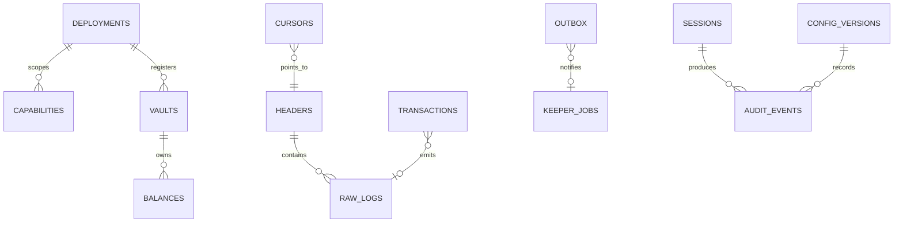

# Database schema and restore overview

## Logical schema

EVM quantities use `numeric(78,0)`. Chain/address and event identities are composite keys. Outbox and keeper-job idempotency keys are unique. Raw logs include block hash so competing forks cannot collide.

## Backup and restore procedure

The authoritative operator procedure is [BACKUP_AND_RESTORE_RUNBOOK.md](./BACKUP_AND_RESTORE_RUNBOOK.md). The summary below does not authorize production access.

1. Stop mutation workers; keep the public read API in maintenance/read-only mode.
2. Record the application Git SHA, manifest version, migration checksum and Railway backup identifier.
3. Take a Railway backup or `pg_dump` using a least-privilege operator credential. Never log the URL.
4. Restore into a new staging database, not over the source database.
5. Run `npm run migrate`; an already-applied checksum must be a no-op and a changed checksum must fail.
6. Validate table counts, constraints, latest cursor/header linkage, unprocessed outbox rows and sampled vault/balance reconciliation.
7. Point a staging API at the restored database and run `npm run check`, `npm run verify:live:contract-wiring`, readiness and smoke tests.
8. Record restore duration, data-loss window, approver and evidence. Promote only by changing the approved secret; retain the old database through the rollback window.

Production restore rehearsal remains an operator-controlled gate because this session was not authorized to create or replace a Railway database.
